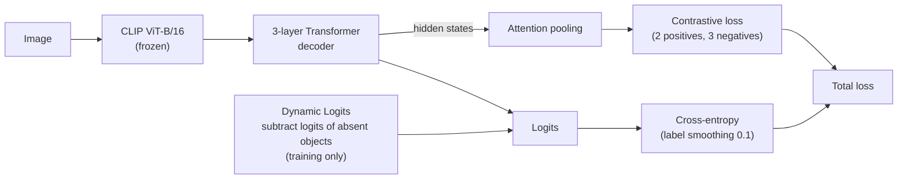
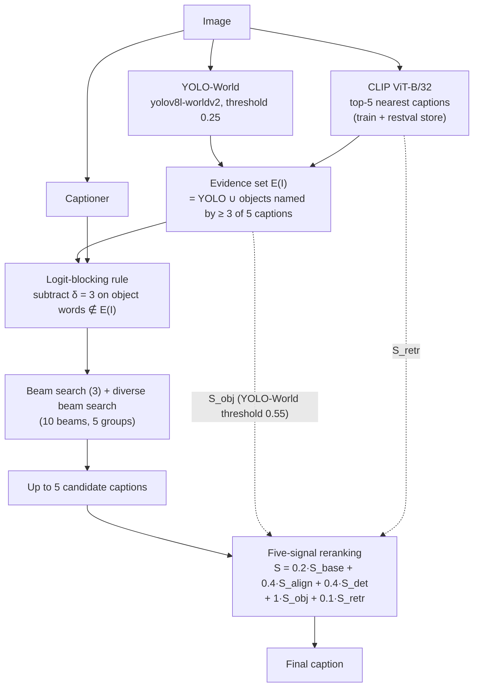

# MEHC-Cap: Multi-Source Evidence-Guided Two-Stage Object Hallucination Control for Transformer-Based Image Captioning

Code for **MEHC-Cap** (Multi-Source Evidence-Guided Hallucination-Controlled Captioning), an image captioning model that reduces
**object hallucination** (captions that mention objects that are not in the image) while keeping caption quality, on a small model
(CLIP ViT-B/16 + Transformer decoder). It contains the training notebooks, the evaluation scripts and a demo web app.

## 1. Problem and idea

Captioning models often mention familiar objects that are not visible (for example writing "dining table" for a kitchen counter).
Hallucination is measured with **CHAIR** (CHAIRs: % of captions with a hallucinated object, CHAIRi: % of mentioned objects that are
hallucinated, over the 80 COCO classes). Caption quality is tracked with BLEU, METEOR, ROUGE-L, CIDEr and SPICE.

The idea is to control hallucination at **three stages**, without retraining the object detector.

1. **Training:** Dynamic Logits (subtract the logits of objects that are absent from the image, training only) and multi-positive contrastive learning with attention pooling.
2. **Decoding:** a fixed logit-blocking rule `z' = z - δ · 1[object word ∉ E(I)]`, where `E(I)` is the set of objects with evidence: detected by YOLO-World **or** named by at least `r = 3` of the `K = 5` retrieved captions.
3. **Selection:** rerank up to 5 candidate captions with five signals.

## 2. Pipeline

**Training** (`notebooks/02`, run on Kaggle)



**Inference** (`eval/` and `notebooks/eval/`)



The five reranking signals (each min-max normalised within one image's candidates):

| Signal | Meaning |
|---|---|
| `S_base` | captioner confidence (mean token log-probability) |
| `S_align` | image-text compatibility (CLIP ViT-B/16 cosine, CLIPScore style) |
| `S_det` | caption probability after belief revision with the detection results |
| `S_obj` | minus the number of object classes in the caption that lie outside `E(I)` |
| `S_retr` | closeness of the candidate to the retrieved captions |

YOLO-World confidence threshold: the blocking rule and `S_det` use 0.25, and only the evidence set of `S_obj` uses 0.55 (chosen on 1,000 validation images).

## 3. Results (Karpathy test sets)

Configuration names list the components that are switched on:

| Code | Meaning |
|---|---|
| `CE` | Baseline, trained with cross-entropy only |
| `DL` / `CL` | Generator with Dynamic Logits only / contrastive learning only |
| `DL+CL` | Proposed generator, with both |
| `LB(·)` | Logit blocking rule, with the evidence source in brackets: `Y` = YOLO-World, `R` = retrieved captions, `Y+R` = union of both |
| `RR` | Five-signal reranker |

MEHC-Cap is the full configuration **`DL+CL + LB(Y+R) + RR`**. MS COCO: 5,000 test images, CHAIR computed on the 4,967 images that have object labels, mean ± sample standard deviation over three training runs (seeds 41, 42, 43, epoch-40 checkpoint of each) for both the baseline and the proposed generator. Flickr30k: one run. CHs/CHi: CHAIRs/CHAIRi (%, lower is better).

| Dataset | Configuration | B-4 | METEOR | ROUGE-L | CIDEr | SPICE | CHs | CHi |
|---|---|---|---|---|---|---|---|---|
| MS COCO | `CE` | 36.31 ± 0.34 | 28.61 ± 0.08 | 57.36 ± 0.14 | 118.91 ± 0.97 | 21.51 ± 0.18 | 7.04 ± 0.08 | 4.87 ± 0.11 |
| MS COCO | `CE + RR` | 35.18 ± 0.37 | 28.30 ± 0.06 | 56.21 ± 0.17 | 118.22 ± 0.86 | 21.57 ± 0.10 | 2.52 ± 0.07 | 1.81 ± 0.05 |
| MS COCO | `DL+CL + LB(Y+R)` | 37.22 ± 0.39 | 28.62 ± 0.10 | 57.60 ± 0.11 | 120.18 ± 0.82 | 21.72 ± 0.11 | 3.19 ± 0.08 | 2.29 ± 0.08 |
| MS COCO | **`DL+CL + LB(Y+R) + RR`** | 36.05 ± 0.17 | 28.44 ± 0.05 | 56.70 ± 0.04 | 119.51 ± 0.43 | 21.70 ± 0.09 | **1.84 ± 0.14** | **1.34 ± 0.10** |
| Flickr30k | `CE` | 32.81 | 24.15 | 52.46 | 73.93 | 17.86 | 6.48 | 4.94 |
| Flickr30k | `CE + RR` | 31.71 | 24.22 | 51.97 | 74.20 | 18.00 | 3.95 | 3.24 |
| Flickr30k | `DL+CL + LB(Y+R)` | 30.21 | 23.85 | 51.97 | 68.06 | 17.73 | 3.24 | 2.62 |
| Flickr30k | **`DL+CL + LB(Y+R) + RR`** | 31.02 | 23.88 | 52.02 | 71.61 | 18.11 | **2.23** | **1.96** |

- On MS COCO the proposed model lowers CHAIRs from 7.04 to 1.84 (-73.9%) and CHAIRi from 4.87 to 1.34 (-72.5%), with CIDEr 0.60 points above the baseline (119.51 vs 118.91) and SPICE 21.70 vs 21.51.
- On Flickr30k CHAIRs drops from 6.48 to 2.23, but CIDEr is 2.32 points below the baseline: there, less hallucination costs some caption quality.
- The model does not lower CHAIR by avoiding objects (three-seed means): 1.34 COCO object classes per caption (proposed) versus 1.46 (baseline) and 1.36 (reference captions), 7.94% of captions mention no COCO object versus 6.31% (references 10.88%), and recall against objects named by the reference captions is 69.23% versus 71.02%.

**Contribution of each reranking signal** (MS COCO test, generator `DL+CL + LB(Y+R)`, mean ± std over seeds 41, 42, 43):

| Configuration | B-4 | CIDEr | CHs | CHi |
|---|---|---|---|---|
| Before reranking | 37.22 ± 0.39 | 120.18 ± 0.82 | 3.19 ± 0.08 | 2.29 ± 0.08 |
| Five signals (r = 3) | 36.05 ± 0.17 | 119.51 ± 0.43 | 1.84 ± 0.14 | 1.34 ± 0.10 |
| Without `S_obj` | 36.29 ± 0.16 | 120.43 ± 0.31 | 2.65 ± 0.14 | 1.89 ± 0.11 |
| Without `S_retr` | 35.86 ± 0.15 | 118.81 ± 0.36 | 1.79 ± 0.14 | 1.32 ± 0.11 |
| Five signals, r = 1 | 36.19 ± 0.11 | 120.10 ± 0.35 | 2.17 ± 0.09 | 1.58 ± 0.06 |

`S_obj` reduces hallucination (removing it raises CHAIRs to 2.65), while `S_retr` keeps caption quality (removing it lowers CIDEr by 0.70 points, with CHAIRs about the same, 1.79 vs 1.84).

**Inference cost (per image, RTX 3050 Laptop):** 1,855 ms for the full pipeline versus 357 ms for the baseline with one beam-search caption. Retrieval adds 52 ms, the two retrieval-based signals 38 ms, YOLO-World 111 ms, the reranker 197 ms.

**On/off ablation (MS COCO, 5,000 images).** "Before"/"after" means before/after adding `RR`. CHAIRs and CHAIRi (%) are computed on 4,967 images, and recall is the % of objects named by the reference captions that the generated caption mentions. The evidence source feeds both the blocking rule and the `S_obj` signal, and the no-blocking rows use the union of both sources. δ = 3 was chosen on the validation split with the union source and kept for the other sources. SPICE was not measured. C1, C2 and C7 to C10 are mean ± sample standard deviation over seeds 41, 42, 43 (epoch-40 checkpoint of each), so C1 and C10 match the main table above. C3 to C6 are single runs of the Dynamic-Logits-only and contrastive-only generators (seed 42, epoch 40) and have no standard deviation.

| # | Configuration | CHAIRs before | CIDEr before | CHAIRs after | CHAIRi after | CIDEr after | Recall after |
|---|---|---|---|---|---|---|---|
| C1 | `CE` | 7.04 ± 0.08 | 118.91 ± 0.97 | 2.52 ± 0.07 | 1.81 ± 0.05 | 118.22 ± 0.86 | 69.30 ± 0.15 |
| C2 | `CE + LB(Y+R)` | 3.64 ± 0.28 | 118.02 ± 1.10 | 1.86 ± 0.18 | 1.36 ± 0.14 | 117.90 ± 1.06 | 68.78 ± 0.01 |
| C3 | `DL` | 7.05 | 119.18 | 3.10 | 2.20 | 119.07 | 70.0 |
| C4 | `DL + LB(Y+R)` | 3.24 | 118.79 | 2.11 | 1.51 | 119.44 | 69.5 |
| C5 | `CL` | 7.15 | 120.43 | 2.88 | 2.03 | 119.56 | 69.9 |
| C6 | `CL + LB(Y+R)` | 3.28 | 120.08 | 1.89 | 1.36 | 120.22 | 69.4 |
| C7 | `DL+CL` | 6.99 ± 0.33 | 121.24 ± 1.00 | 2.69 ± 0.04 | 1.96 ± 0.06 | 119.80 ± 0.43 | 69.74 ± 0.04 |
| C8 | `DL+CL + LB(Y)` | 2.77 ± 0.19 | 119.04 ± 0.87 | 1.35 ± 0.09 | 1.03 ± 0.08 | 116.61 ± 0.59 | 66.68 ± 0.03 |
| C9 | `DL+CL + LB(R)` | 2.66 ± 0.12 | 115.49 ± 0.79 | 1.62 ± 0.20 | 1.44 ± 0.15 | 112.59 ± 0.38 | 59.54 ± 0.22 |
| **C10** | **`DL+CL + LB(Y+R)`** | **3.19 ± 0.08** | **120.18 ± 0.82** | **1.84 ± 0.14** | **1.34 ± 0.10** | **119.51 ± 0.43** | **69.23 ± 0.09** |

Observations:
- Logit blocking removes the most hallucination at generation time: CHAIRs 6.99 (C7) to 3.19 (C10) for the proposed generator, 7.04 (C1) to 3.64 (C2) for the baseline.
- Without blocking, the proposed generator has about the same hallucination as the baseline (CHAIRs before 6.99 vs 7.04, after `RR` 2.69 vs 2.52) and a higher CIDEr (119.80 vs 118.22 after `RR`). With blocking on for both, C10 and C2 reach about the same CHAIRs (1.84 vs 1.86), and C10 keeps 1.61 points more CIDEr (119.51 vs 117.90).
- With blocking, Dynamic Logits only (C4, single run) gives CHAIRs 2.11 and contrastive only (C6, single run) 1.89, both above the combination (C10, 1.84 ± 0.14), C6 within one standard deviation of it.
- YOLO-World-only (C8) or retrieval-only (C9) evidence gives lower CHAIRs (1.35 and 1.62), but CIDEr drops by 2.90 and 6.92 points against C10 and recall falls to 66.68% and 59.54%, i.e. the model mentions far fewer objects. The union source balances hallucination and caption quality, so it is the one used.


**Seed scope of each result.** Every number above comes from one of these sources:

| Result | Generator checkpoints | Images |
|---|---|---|
| Main table (MS COCO), reranking-signal table, on/off rows C1, C2, C7 to C10 | Seeds 41, 42, 43 of the baseline and of the proposed model, epoch 40 of each, mean ± sample std | 5,000 test images (CHAIR on 4,967) |
| On/off rows C3 to C6 | One run: Dynamic-Logits-only and contrastive-only generators, seed 42, epoch 40 | 5,000 test images |
| Choice of δ (blocking strength) and of the `S_obj` YOLO-World threshold (0.55) | Proposed model, seed 42, epoch 40 | First 1,000 validation images |
| Flickr30k rows | One run of the baseline and of the proposed model | 1,000 test images |
| Inference cost | Proposed model, seed 42, epoch 40 | Test images, RTX 3050 Laptop |

`python eval/make_tables.py --dir results/kaggle` rebuilds the main table, the reranking-signal table and the three-seed on/off rows from the released result files (section 6), on CPU and without images or models.

## 4. Folder layout

| Path | Role |
|---|---|
| `requirements.txt` | Python packages for `core/` and `eval/` (the web app has its own `webapp/backend/requirements.txt`) |
| `core/` | Shared modules imported by every script in `eval/`: captioner (`local_captioner.py`, `generate.py`), CLIPScore (`clipscore.py`), YOLO-World wrapper (`yolo_objects.py`), three-signal reranker (`formula_reranker.py`), metrics (`evaluate_reranked_quality.py`, `chair_metric.py` + `chair_synonyms.txt`), data classes (`schema.py`, `config.py`, `vocab.py`, `pipeline.py`) |
| `notebooks/01_baseline_clipvit-transformer-coco2014.ipynb` | Train the baseline (cross-entropy) for 40 epochs; the reported runs use `SEED` = 41, 42, 43 and the epoch-40 checkpoints (`baseline_epoch40_seed{41,42,43}.pth`) |
| `notebooks/02_train_proposed_dynlogits_contrastive_attnpool.ipynb` | Train the **proposed generator** (Dynamic Logits + multi-positive contrastive learning + attention pooling); the first cell describes the exact schedule that produced the three reported checkpoints (`seed{41,42,43}_dynlogits_contrastive_attnpool_epoch40_model.pth`) |
| `notebooks/03_flickr30k_train_baseline.ipynb`, `04_flickr30k_train_proposed.ipynb` | Train baseline and proposed model on Flickr30k |
| `notebooks/eval/coco2014-eval-preranking.ipynb` | Evaluate captions before reranking (plain beam search) |
| `notebooks/eval/coco2014-eval-reranking.ipynb` | Full pipeline on Kaggle: candidate generation with the blocking rule, then reranking; writes the three-seed result files |
| `eval/build_yoloworld_report.py` | Create the evaluation report of a split with the YOLO-World objects (the detection evidence) |
| `eval/build_retrieval_cache.py` | Encode the train + restval captions with CLIP ViT-B/32 and store the top-5 caption neighbours of every image |
| `eval/retrieval_logit_bias_experiment.py` | Generate candidate captions with the blocking rule (`--configs 0,δ`), evidence source `--evidence union/yolo/retr` |
| `eval/run_onoff_ablation.sh`, `onoff_postprocess.py` | Run a configuration on the 5,000 test images in 4 shards, then merge the shards and score the five-signal reranker |
| `eval/rerank_only_test55.py`, `rerank_c55_rest.py` | Re-score already generated candidates with the 0.55 YOLO-World threshold for `S_obj` (no regeneration) |
| `eval/sobj_threshold_eval.py`, `sobj_threshold_val.py` | Score the five-signal reranker (threshold r, evidence source, SPICE, object coverage) on test and val |
| `eval/sretr_experiment.py`, `signal_table.py`, `rerank_with_new_objects.py` | `S_obj`/`S_retr` signals and the retrieval cache; signal table; reranking with a new object set |
| `eval/logit_bias_final_eval.py` | Merge shards and compute all metrics for a blocking run |
| `eval/eval_notebook_json.py`, `spice_per_caption.py` | Re-score a Kaggle result file on CPU and add SPICE (writes `<file>_cpu_eval.json`) |
| `eval/make_tables.py` | Rebuild the three-seed tables of section 3 from the result files |
| `eval/flickr30k_eval.py` | Flickr30k evaluation (logit blocking + reranking) |
| `logs/clean_env_check.log` | Run of the instructions below in a fresh virtual environment (install, every script's `--help`, step 0, a CPU re-score and a 5-image smoke test of steps 2 to 4) |
| `webapp/` | Demo app (FastAPI + Next.js) that runs the pipeline step by step; see `webapp/README.md` |
| `papers/` | The 46 references of the paper, with DOI or paper links; see `papers/README.md` |
| `references.bib` | BibTeX of the 46 references, keys `ref1` to `ref47` (no `ref18`) in order of first citation |

## 5. Setup, data and checkpoints

All commands run from the repository root.

```
python -m venv .venv          # Python 3.10
.venv\Scripts\activate        # Linux/macOS: source .venv/bin/activate
pip install -r requirements.txt
```

Install the CUDA build of PyTorch first if you have a GPU (see the comment at the top of `requirements.txt`). METEOR needs Java on `PATH`, SPICE needs Java 8. The CLIP models (`openai/clip-vit-base-patch16`, `openai/clip-vit-base-patch32`) are downloaded from Hugging Face, and `yolov8l-worldv2.pt` is downloaded by Ultralytics, on first use.

**Data.** Download the files below and place them as shown (the folders `dataset/`, `checkpoints/` and `results/` are not tracked by git):

| File | Source |
|---|---|
| `dataset/val2014/*.jpg` | MS COCO 2014 validation images, <https://cocodataset.org/#download> (`val2014.zip`); the Karpathy val and test images are all in val2014 |
| `dataset/instances_val2014.json` | MS COCO 2014 annotations (`annotations_trainval2014.zip`), used as CHAIR ground truth |
| `dataset/dataset_coco.json` | Karpathy split of MS COCO (`caption_datasets.zip` from <https://cs.stanford.edu/people/karpathy/deepimagesent/>) |
| `dataset/flickr30k/dataset_flickr30k.json`, `dataset/flickr30k/images/` | Karpathy split of Flickr30k (same zip) and the Flickr30k images (<https://shannon.cs.illinois.edu/DenotationGraph/>), only for `eval/flickr30k_eval.py` |
| `dataset/coco2014_karpathy_restval_dynlogits_contrastive_attnpool_vocab.json` | Vocabulary (10,031 words), written by notebook 02 and included in the release below |

The training notebooks read `train2014/` and `val2014/` images, `dataset_coco.json` and the `instances_*2014.json` files from Kaggle inputs; set the paths in their configuration cell.

```
dataset/
  dataset_coco.json
  instances_val2014.json
  coco2014_karpathy_restval_dynlogits_contrastive_attnpool_vocab.json
  val2014/COCO_val2014_000000000042.jpg ...
  retrieval_cache/          # written by eval/build_retrieval_cache.py
  flickr30k/                # optional
checkpoints/                # *.pth from the release
results/                    # outputs; results/kaggle/ holds the released result files
```

The release also contains `results/kaggle/`: for every checkpoint and setting of the main and on/off tables (18 runs), the result file of `notebooks/eval/coco2014-eval-reranking.ipynb` with, per test image, the YOLO-World objects, the retrieved neighbours, the evidence set, all candidate captions, their reranking scores (`S_base`, `S_align`, `S_det` and the total), the caption before reranking and the selected caption, plus the stored metrics. Next to each main-table file are `_cpu_eval.json` (CPU re-score with SPICE) and `_spice_per_caption.json`. `results/kaggle/SHA256SUMS` lists their checksums.

## 6. Reproducing the results

The full flow is: prepare the data, train, generate candidates, rerank, compute the metrics, build the tables. Steps 2 to 5 need a GPU (we used a Kaggle T4 for training and an RTX 3050 Laptop for local evaluation). Keep at most 2 GPU processes at a time.

`logs/clean_env_check.log` shows these steps run in a fresh virtual environment on CPU (steps 2 to 4 on 5 test images).

**Step 0. Tables from the released files (CPU only).**

```
python eval/make_tables.py --dir results/kaggle
```

**Step 1. Train** on Kaggle (T4): notebook 01 for the baseline and notebook 02 for the proposed generator, once per `SEED` in 41, 42, 43, then keep the epoch-40 checkpoint (the `_epoch40_` file, not `_best_model`). Notebook 02 also writes the vocabulary file. The Dynamic-Logits-only and contrastive-only generators (C3 to C6) are notebook 02 with `SEED = 42` and `USE_CONTRASTIVE_LOSS = False` (DL only) or `TRAIN_DECODER_INTERCEPT = False` (CL only). Their Kaggle runs used `EPOCHS = 50` (DL only) and `EPOCHS = 45` (CL only, resumed after epoch 37 with `RESUME_PEAK_LR = 5e-5`), so their learning-rate schedules differ from the proposed generator's; the epoch-40 checkpoint of each is evaluated.

**Step 2. Evaluation reports, YOLO-World evidence and retrieval cache** for the test split and for the first 1,000 validation images:

```
python eval/build_yoloworld_report.py --split test --output results/test_yoloworld.json
python eval/build_yoloworld_report.py --split val --max-rows 1000 --output results/val1000_yoloworld.json
python eval/build_retrieval_cache.py --report results/test_yoloworld.json
python eval/build_retrieval_cache.py --report results/val1000_yoloworld.json
```

The first `build_retrieval_cache.py` call also encodes the 566,747 train + restval captions once (`dataset/retrieval_cache/train_captions.json`, `train_caption_emb_b32.npy`).

**Step 3. Choose δ on validation** (seed-42 epoch-40 proposed checkpoint, first 1,000 val images). Pick the δ with the lowest CHAIRs after reranking whose CIDEr is not more than 1 point below the no-blocking case; this gives δ = 3:

```
python eval/retrieval_logit_bias_experiment.py --report results/val1000_yoloworld.json --max-images 1000 --maj 3 --checkpoint checkpoints/seed42_dynlogits_contrastive_attnpool_epoch40_model.pth --vocab-file dataset/coco2014_karpathy_restval_dynlogits_contrastive_attnpool_vocab.json --configs 0,0 0,1 0,2 0,3 0,4 --output results/ksweep_val1000.json
```

**Step 4. Generate candidates on test, rerank and score.** Three-seed rows: run `notebooks/eval/coco2014-eval-reranking.ipynb` on Kaggle once per checkpoint (six checkpoints) with `RUN_BOTH = True`, which writes one file for δ = 0 and one for δ = 3; for C8 and C9 use `RUN_BOTH = False` and `EVIDENCE_SOURCES = ["yolo", "retr"]` with the three proposed checkpoints. Copy the files to `results/kaggle/` and add SPICE on CPU:

```
python eval/eval_notebook_json.py results/kaggle/eval_rerank_*_test.json --spice
python eval/make_tables.py --dir results/kaggle
```

The same steps run locally, one configuration at a time, with `eval/run_onoff_ablation.sh` (4 shards of 1,250 images, finished shards are skipped). Set `PY`, `E40`, `BASE`, `DL`, `CL` to change the Python interpreter or a checkpoint:

```
bash eval/run_onoff_ablation.sh P    # proposed generator, δ = 3 (e40_g3), the final configuration
bash eval/run_onoff_ablation.sh C    # DL only, δ = 0 and 3 (C3, C4)
bash eval/run_onoff_ablation.sh D    # CL only, δ = 0 and 3 (C5, C6)
python eval/onoff_postprocess.py --name e40_g3 --evidence union --spice
python eval/onoff_postprocess.py --name dl_g0 --evidence union
```

`onoff_postprocess.py` merges the shards into `results/onoff/<name>_merged.json` and scores the reranker with `S_obj` evidence at the generation threshold. The reported numbers use the 0.55 threshold for `S_obj`, which only changes the reranking step, so the candidates are re-scored without regeneration:

```
python eval/rerank_only_test55.py test         # proposed model: all reranker variants, SPICE for the five-signal one
python eval/rerank_c55_rest.py dl_g0           # same for an on/off configuration (cs_g0, e40_g0, e40_yolo, cl_g0, cl_g3, dl_g0, dl_g3, signals)
```

Results go to `results/confsweep/rr55/`; the key `five_score_3of5` is the final MEHC-Cap configuration and `before_rerank` is the first beam-search caption.

**Step 5. Flickr30k** (`eval/flickr30k_eval.py`, see its docstring): choose δ on the validation split with `run --split val` and `merge --select`, then run the test split once.

Final MEHC-Cap settings: YOLO-World threshold 0.25 (at most 20 objects) for the blocking rule and `S_det`, 0.55 for the evidence set of `S_obj`, `K = 5`, `r = 3`, `δ = 3`, `J = 5` candidates, weights `w_base/w_align/w_det/w_obj/w_retr = 0.2/0.4/0.4/1/0.1`, `ε = 10⁻⁶`.
